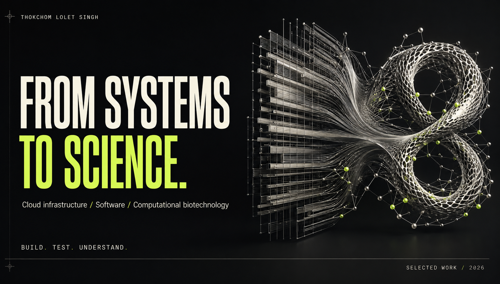
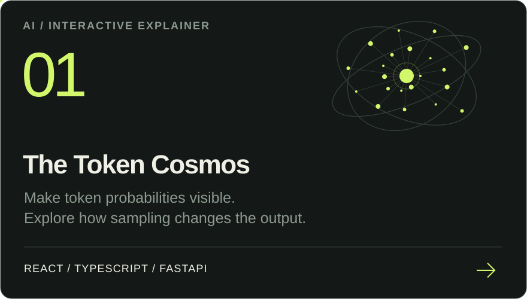
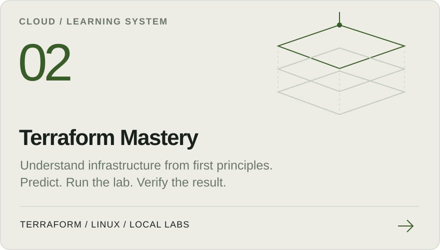
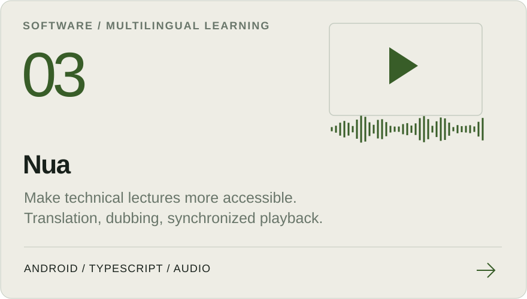
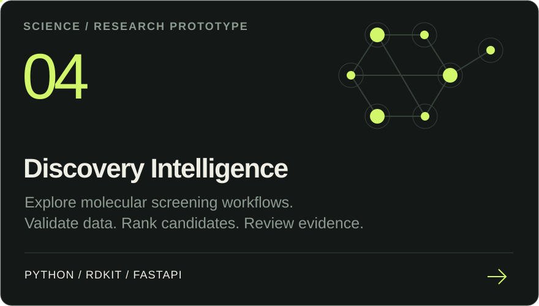
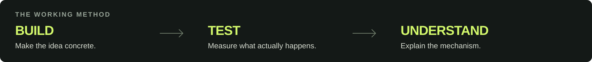

  

  <a href="./learning-hub/README.md"><b>LEARNING HUB ↗</b></a> &nbsp; / &nbsp;
  <a href="https://lolet-observatory.lolet.chatgpt.site"><b>ENTER THE OBSERVATORY ↗</b></a> &nbsp; / &nbsp;
  <a href="#selected-work"><b>EXPLORE THE WORK</b></a> &nbsp; / &nbsp;
  <a href="https://thokchomlolet03-cpu.github.io/my-tech-blog/"><b>READ THE NOTES</b></a> &nbsp; / &nbsp;
  <a href="https://www.linkedin.com/in/thokchom-lolet-singh-b77341b2/"><b>LET'S CONNECT ↗</b></a>

 

I'm **Lolet** — an enterprise IT support professional based in the UAE, concentrating on operating systems, Windows/macOS endpoint administration, networks, technical troubleshooting, and reliable infrastructure automation. I also build independent software and research projects. My background includes three years of Level 2 support for Finastra through Tech Mahindra, where I worked across user devices, identity and access, collaboration tools, incident management, and technical escalations.

My current professional focus is progressing from enterprise IT support into Windows/Linux systems administration, endpoint engineering and infrastructure automation. Outside that career path, I also explore longer-term independent research in computational biotechnology.

## Personal Learning Hub — one bookmark for daily study

**[Open the Learning Hub](./learning-hub/README.md)** to launch German courses, engineering incident reports, and my source-based NotebookLM notes without searching across websites.

| Choose a track | Start here |
|---|---|
| **German A1 → C2** | [Level-by-level courses, practice and exam preparation](./learning-hub/german/README.md) |
| **Real engineering failures** | [Netflix, Cloudflare, GitHub, Spotify and Google SRE investigations](./learning-hub/engineering-incidents/README.md) |
| **NotebookLM deep dives** | [Notebook index](./learning-hub/notebooklm/INDEX.md) · [Share a public notebook](https://github.com/thokchomlolet03-cpu/thokchomlolet03-cpu/issues/new?template=notebooklm-link.yml) |

German study is an ongoing personal goal, **not a claim of a certified CEFR level**. NotebookLM links are added only when safe to share publicly.

## Professional foundation

- **Enterprise support:** Microsoft 365 and Teams, Active Directory / Entra ID, Windows and macOS, JAMF, Intune, SCCM, ServiceNow, and secure connectivity. Six Tech Mahindra Bravo Awards.
- **Independent engineering:** Python, FastAPI, Docker, GitHub Actions, Terraform learning labs, and cloud deployment experiments. These are projects and labs, not claims of commercial production operation.
- **Working method:** Build something testable, observe failures, document limitations, and revise the explanation when evidence changes.

**[Project guide: purpose, evidence, maturity, and limitations](./PROJECT_GUIDE.md)**

## Systems & Infrastructure Engineering

My focused career-development and hands-on systems portfolio is now organized in **[Systems & Infrastructure Engineering](./systems-infrastructure/README.md)** — an evidence-first learning workbench for Linux and Windows OS internals, networking, enterprise endpoint management (Intune/Jamf), Bash/PowerShell/Python automation, Ansible and reliability.

Start with the [24-month roadmap](./systems-infrastructure/ROADMAP.md), [official learning resources](./systems-infrastructure/LEARNING_RESOURCES.md), [certification priorities](./systems-infrastructure/CERTIFICATIONS.md) or the [recruiter-facing evidence index](./systems-infrastructure/RECRUITER_PORTFOLIO.md). **The syllabus is a plan; incomplete projects and unearned certifications are explicitly labelled.**

### Current systems-engineering workbench

| Project | Engineering question | Evidence status |
|---|---|---|
| [Linux Diagnostics (P01)](./systems-infrastructure/projects/p01-linux-diagnostics/README.md) | How do we observe CPU, memory, storage, processes and failure conditions safely? | Source + preliminary assistant-side tests; **owner validation pending** |
| [Linux Service Fault Lab (P03)](./systems-infrastructure/projects/p03-service-failure-lab/README.md) | How do we distinguish configuration, port and systemd failures? | Four assistant-side unit tests; **systemd lab pending** |
| [Windows Infrastructure (P04)](./systems-infrastructure/projects/p04-windows-infrastructure/README.md) | How do DNS, Active Directory, GPO and PowerShell fit together? | Read-only script drafted; **Windows VM lab pending** |
| [Virtualization & Recovery (P13)](./systems-infrastructure/projects/p13-virtualization-recovery/README.md) | Can a service be restored from independent backups after a VM failure? | **Planned lab; no restore claim** |

[Evidence and role-readiness index](./systems-infrastructure/RECRUITER_PORTFOLIO.md) · [Role requirements and capability tracking](./systems-infrastructure/CAREER_EVIDENCE_SYSTEM.md)

## Other selected software and research work

Four ways I explore that direction. **Each card opens the source.**

  <a href="https://github.com/thokchomlolet03-cpu/the-token-cosmos"><picture><source media="(max-width: 640px)" srcset="./assets/cosmos-mobile.svg"></picture></a>
  <a href="https://github.com/thokchomlolet03-cpu/terraform-mastery"><picture><source media="(max-width: 640px)" srcset="./assets/terraform-mobile.svg"></picture></a>

  <a href="https://github.com/thokchomlolet03-cpu/Nua"><picture><source media="(max-width: 640px)" srcset="./assets/nua-mobile.svg"></picture></a>
  <a href="https://github.com/thokchomlolet03-cpu/discovery_intelligence_system"><picture><source media="(max-width: 640px)" srcset="./assets/discovery-mobile.svg"></picture></a>

 

<picture><source media="(max-width: 640px)" srcset="./assets/method-mobile.svg"></picture>

 

## The longer arc

**[Mangal BioTech ↗](https://github.com/thokchomlolet03-cpu/mangal-biotech)** 
A simulated-company framework for my systems and research-data portfolio. The public repository establishes how assignments should document requirements, architecture, tests, costs, and recovery.

**[Longevity Research Journey ↗](https://thokchomlolet03-cpu.github.io/longevity-research-journey/)** 
A public record of study, projects, evidence, and changes of mind along the path toward computational longevity research.

<b>Technical focus & research boundaries</b>

 

- **Systems:** Linux, networking, Terraform, Docker, AWS, and Google Cloud.
- **Software:** Python, TypeScript, React, Astro, and FastAPI.
- **Exploratory research:** [Universal Inverse Design](https://github.com/thokchomlolet03-cpu/universal-inverse-design) investigates biomedical knowledge graphs and candidate-generation workflows.
- **Evidence:** Learning projects, demonstration data, simulations, and research prototypes are identified as such. Generated candidates and model scores do not establish biological efficacy or validated therapies. The Token Cosmos distinguishes synthetic demonstration candidates from model output.

 

**Open to IT support engineering, endpoint administration, systems/infrastructure operations, and cloud support opportunities internationally, including relocation.** 
[Connect on LinkedIn ↗](https://www.linkedin.com/in/thokchom-lolet-singh-b77341b2/) · [Read Friction Hunter ↗](https://thokchomlolet03-cpu.github.io/my-tech-blog/)

 

